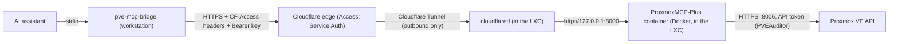

# Read-only Proxmox MCP server behind Cloudflare Access

This guide shows how to run [ProxmoxMCP-Plus](https://github.com/RekklesNA/ProxmoxMCP-Plus) v0.6.3 in read-only mode inside an unprivileged Proxmox LXC container. The server is published through a Cloudflare Tunnel, protected by Cloudflare Access with a service token, and connected to an AI assistant through a small stdio bridge.

The result: your assistant can list nodes, VMs, containers, storage, logs and backups. It cannot start, stop, create, change or delete anything.

Every step was run on a real home lab. The places where things went wrong are documented too, so you can skip those detours.

## Contents

| Doc | What it covers |
|---|---|
| [01. Proxmox prerequisites](docs/01-proxmox-prereqs.md) | lxc-pve version, read-only user and API token, certificate check |
| [02. Create the LXC](docs/02-create-lxc.md) | Container creation, features, networking (and the VLAN lesson) |
| [03. Docker](docs/03-docker.md) | Docker Engine and Compose inside the container |
| [04. ProxmoxMCP-Plus](docs/04-proxmoxmcp-plus.md) | Pinned clone, config, build, start, local tests |
| [05. Cloudflare Tunnel](docs/05-cloudflare-tunnel.md) | Dashboard-managed tunnel, plus a locally-managed appendix |
| [06. Cloudflare Access](docs/06-cloudflare-access.md) | Service token, Access application, Service Auth policy, tests |
| [07. Connect a client](docs/07-connect-client.md) | stdio bridge, client config, smoke test |
| [08. Troubleshooting](docs/08-troubleshooting.md) | Errors seen along the way and their fixes |
| [09. Maintenance](docs/09-maintenance.md) | Updates, secret rotation, backups, expiry alerts |

Other folders:

| Path | Contents |
|---|---|
| [files/](files/) | `config.json`, `.env.example` and `compose.yaml` with placeholders |
| [bridge/](bridge/) | `pve_mcp_bridge.py`, the `pve-mcp-bridge` wrapper and `test_bridge.py` |

## Architecture

Request path in words:

1. The assistant starts the bridge as a local stdio MCP server.
2. The bridge sends each request over HTTPS to `https://<MCP_HOSTNAME>/mcp` with three headers: the Cloudflare Access client ID, the client secret and a bearer key.
3. Cloudflare Access checks the service token. Requests without it get a 403 and never reach your network.
4. The tunnel delivers the request to `cloudflared` inside the container, which forwards it to `127.0.0.1:8000`.
5. ProxmoxMCP-Plus checks the bearer key and the Host header, then calls the Proxmox API with a read-only token.

No inbound port is opened on your router. The MCP port listens on loopback only.

## Security model

Six independent layers. Each one would block writes or access on its own.

| # | Layer | What it enforces |
|---|---|---|
| 1 | Proxmox RBAC | The API token has privilege separation and only the `PVEAuditor` role. Proxmox itself refuses every write. This is the real boundary. |
| 2 | Read-only target | `"readonly": true` in `config.json`. The server's dispatcher blocks any tool outside its built-in read-only set for that target. |
| 3 | Tool allowlist | `MCP_TOOL_ALLOWLIST` registers only 29 read-only tools. Unknown names make startup fail. |
| 4 | Command policy, no SSH | `command_policy` is `deny_all` for guest commands. High-risk operations need an approval token that is never configured, so they are denied. No `ssh` block exists, so node shell tools have no path. |
| 5 | Transport | Bearer key required (startup fails without one), Host header allowlist (DNS rebinding protection), port published on `127.0.0.1` only, container runs as uid 1000 with `cap_drop: ALL` and `no-new-privileges`. |
| 6 | Cloudflare | Tunnel is outbound only. Access application with a single Service Auth policy, so only holders of the service token get through. No browser login path exists. |

What read-only still exposes: inventory, VM and container configs, node syslog, task logs, firewall logs and backup lists. Treat the bearer key and service token as sensitive, even though they cannot change anything.

## Prerequisites

| Item | Notes |
|---|---|
| Proxmox VE 8 or newer | `lxc-pve` must be 6.0.5-2 or newer for Docker in an unprivileged LXC. See [01](docs/01-proxmox-prereqs.md). |
| Root shell on the Proxmox node | Web UI shell or SSH. |
| A domain on Cloudflare | The zone must be active (nameservers pointed at Cloudflare). |
| Cloudflare Zero Trust organization | The free plan is enough. |
| A LAN router where you can reserve DHCP addresses | Optional, but recommended. |
| A workstation with bash, curl and [uv](https://docs.astral.sh/uv/) | For tests and the bridge. Linux or macOS. Windows notes are in [07](docs/07-connect-client.md). |
| An MCP client that can run stdio servers | For example Claude Desktop or Claude Code. |

## Variables

Replace these placeholders everywhere they appear. Examples use the RFC 5737 documentation range and `example.com`.

| Placeholder | Meaning | Example |
|---|---|---|
| `<PVE_IP>` | Management IP of the Proxmox host | `192.0.2.10` |
| `<PVE_NODE>` | Proxmox node name | `pve` |
| `<LAN_SUBNET>` | LAN subnet of the management network | `192.0.2.0/24` |
| `<LAN_GATEWAY>` | Default gateway of that subnet | `192.0.2.1` |
| `<MGMT_BRIDGE>` | Bridge that carries the host's management IP | `vmbr0` |
| `<CTID>` | Container ID | `113` |
| `<CT_HOSTNAME>` | Container hostname | `pve-mcp` |
| `<CT_IP>` | Container IP (reserved in DHCP) | `192.0.2.50` |
| `<DOMAIN>` | Your Cloudflare zone | `example.com` |
| `<MCP_HOSTNAME>` | Public hostname for the MCP server | `pve-mcp.example.com` |
| `<TOKEN_USER>` | Read-only Proxmox user. This guide writes it as `mcp-ro@pve`. If you pick another name, change it everywhere. | `mcp-ro@pve` |
| `<TOKEN_NAME>` | API token name under that user | `mcp` |
| `<TUNNEL_NAME>` | Cloudflare Tunnel name | `pve-mcp` |
| `<ACCESS_APP_NAME>` | Cloudflare Access application name | `pve-mcp` |
| `<SERVICE_TOKEN_NAME>` | Cloudflare Access service token name | `mcp-client` |
| `<BACKUP_STORAGE>` | Proxmox storage for vzdump backups | `local` |

Secrets (never commit, never paste into chat or tickets):

| Placeholder | What it is | Where it lives |
|---|---|---|
| `<TOKEN_SECRET>` | Proxmox API token secret (a UUID, shown once) | `config.json` in the container only |
| `<MCP_API_KEY>` | 64-character hex bearer key | `.env` in the container, and the client config |
| `<TUNNEL_TOKEN>` | cloudflared tunnel token | The cloudflared systemd unit in the container |
| `<CF_ACCESS_CLIENT_ID>` | Access service token Client ID | Client config only |
| `<CF_ACCESS_CLIENT_SECRET>` | Access service token Client Secret (shown once) | Client config only |

## Conventions

Every procedure is a list of numbered steps. Each step runs one command and says where it runs:

| Label | Where | Prompt |
|---|---|---|
| `[NODE]` | Root shell on the Proxmox host (web UI > Datacenter > node > Shell, or SSH) | `root@pve:~#` |
| `[CT]` | Root shell in the container (`pct enter <CTID>` from the node, or the CT console) | `root@pve-mcp:~#` |
| `[DASHBOARD]` | A web UI: Proxmox, Cloudflare, or your router | n/a |
| `[WORKSTATION]` | Your own computer | your usual prompt |

Notes:

- Check the prompt before you paste. Most errors in this guide came from running a command in the wrong shell.
- Workstation commands are written for bash. They also work in zsh. fish users: the commands work as shown, but avoid heredocs (fish has none). This guide does not use any.
- Commands that contain a secret start with a space. In bash that keeps them out of history when `HISTCONTROL` includes `ignorespace` or `ignoreboth`. [05](docs/05-cloudflare-tunnel.md) shows how to set it.
- Cloudflare renames dashboard menus from time to time. Where a menu name is known to differ between UI versions, both names are given.

## Versions tested

| Component | Version |
|---|---|
| ProxmoxMCP-Plus | v0.6.3, commit `9aa91b3cbfcad1b1e69accde7bfa593a44669fd7` |
| Container template | `debian-12-standard_12.2-1_amd64` (upgraded after first boot) |
| MCP Python SDK (bridge) | `mcp==1.30.0` |
| Python (bridge) | 3.13, managed by uv |

Check the [ProxmoxMCP-Plus releases](https://github.com/RekklesNA/ProxmoxMCP-Plus/releases) before you start. If a newer tag exists, read [09](docs/09-maintenance.md) for what to re-check.

## Credits and license

This guide and the bridge code are MIT licensed. See [LICENSE](LICENSE). Copyright 2026 Tempus Thales ([@tempusthales](https://github.com/tempusthales)).

ProxmoxMCP-Plus is a separate project by RekklesNA, released under its own license: <https://github.com/RekklesNA/ProxmoxMCP-Plus>. This repo does not contain or redistribute its code. It is not affiliated with Proxmox Server Solutions, Cloudflare or RekklesNA.
